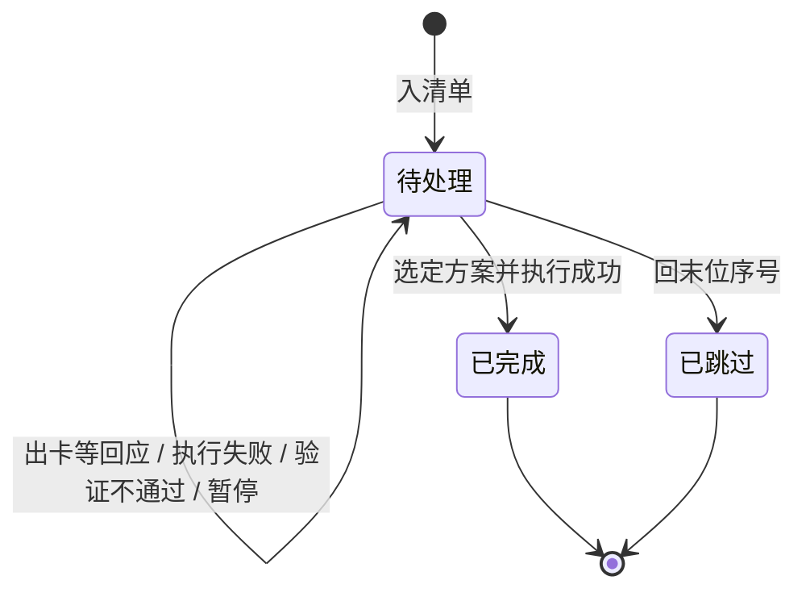

# Process Issues One By One

## 适用场景

### 目标

一次只处理一项：说清问题与场景、各方案的改动与代价，就地给出推荐；
用户回序号当即处理，收尾落盘后经同意再处理下一项。

### 适用

- 用户给出缺陷、告警、待办或评审项清单，要求逐项处理。
- 用户要先看各方案的做法与代价再拍板。

### 不适用

- 只要清单整理或优先级排序，不做逐项处理。
- 用户要一次输出全部，或先批量决策再统一修复；先确认是否放弃逐项模式。

## 前置条件

### 输入与默认值

- 输入：清单文本、清单文件路径或缺陷链接；续跑另需进度文件。
- 顺序：按原顺序；用户给了优先级则沿用。
- 执行边界：默认决策后立即执行并验证；用户说 **只给方案** 时只出卡、不动手。
- 进度文件：清单同目录的 `清单名-progress.md`；对话清单用 `issue-progress.md`。

### 信息缺失处理

- 清单为空或解析不出条目：请用户补充，不虚构。
- 含义有歧义：保留原文并标注待确认。
- 给不出可靠方案：先做只读诊断，仍不足时在卡片里写明缺口。

## 执行步骤

### 步骤 1：建清单

- 操作：
  - 逐项编号，每项一句话标题加来源：文件与行号、日志片段或链接。
  - 所有项记 `待处理`；不预决策、不批量出卡。
  - 不输出清单总览，直接出第一张卡，见步骤 2。
  - 续跑时读进度文件核对，不一致先问以哪个为准：
    `已完成`、`已跳过` 是终态，不再重排；
    `待处理` 且决策列有方案的，复述决策与已做改动，从步骤 4 继续；
    其余按原顺序取第一项。
  - 建进度文件，同名文件先读不覆盖。没有 `待处理` 项时进步骤 5。
- 完成标志：编号连续，进度与清单一致，写不了时说明并改用对话内记录，当前项确定。

### 步骤 2：出诊断卡

- 操作：只输出当前项的诊断卡见 **单项诊断卡**，三段齐全，不加流程说明或工具说明；
  状态仍为 `待处理`，只读诊断可直接做。
- 完成标志：卡片三段齐全，输出停在等用户回应处。

### 步骤 3：接决策

- 操作：按 **决策选项** 处理回应：方案序号与末位序号不再二次确认，其他文字先复述调整点；**只给方案** 模式下只写决策列并说明未执行。
- 完成标志：决策进决策列走步骤 4，或状态改 `已跳过` 走步骤 5；
  未获决策则保持 `待处理` 并停止。

### 步骤 4：执行并验证

- 操作：
  - 只改所选方案的范围；执行中新发现的问题追加到清单尾部记 `待处理`，不切换任务。
  - 方案未列出的副作用先停下说明；确认继续则照原方案，不继续按失败分支处理。
  - 按问题现状里的复现路径实际验证，说清怎么验、结果如何；没跑就说未验证。
  - 成功：状态改 `已完成`，写入决策、改动、验证结果、副作用；没跑验证时验证结果写 `未验证`，汇报里明说。
  - 失败或验证不通过：保持 `待处理`，报失败步骤、证据、副作用与恢复建议，证据写备注，停在本项；
    用户回别的序号即换方案，回末位序号按步骤 3 收尾；未解决前不问下一项。
  - 中途叫停：暂停仍记 `待处理`，备注写 `已改动未验证`；改主意回末位序号按步骤 3 收尾。
- 完成标志：本项为 `已完成` 或 `已跳过` 走步骤 5，或停在 `待处理` 等决定。

### 步骤 5：汇报并问下一项

- 操作：
  - 汇报状态、改动、验证结果、副作用与遗留风险；未验证如实标注，`已跳过` 说明原因。
  - 还有 `待处理` 项：用提问工具问 `继续下一项`、`暂停`；无工具则用文本提问并结束本轮。
    同意才走步骤 2；暂停、未答复都不推进。
  - 没有 `待处理` 项：汇总各项状态、未验证项与遗留风险，按 **验收标准** 核对后收尾。
  - 收尾验收不通过：能自修正的先修正重检一次；仍不过则停止并报告失败项、已完成操作与缺口，
    询问用户；用户要求继续最多再重检一次，仍不过就保持原状态报告。
- 完成标志：结果已汇报；下一项经同意后呈现，或已汇总收尾。

## 约束

### 逐项推进

- 一次一项：出卡、决策、当即修复、落盘、问下一项；不批量决策、不提前出卡、不给总览。
- 用户沉默不自行推进。

### 方案与推荐

- 每项 2 至 3 个差异明显的方案：首行一句话说做法，子行写改动与代价；不凑数，也不拆同一方案。
- 只有一个可行方案时只列 1 个，首行注明 **唯一可行**。
- 推荐写在对应方案首行末尾的 **推荐**，不单设章节、不重排顺序、不把选择推回用户。
- 方案序号只给方案；`跳过` 固定为末位序号。
- 代价里分清已验证与未验证，不把推测写成事实。

### 执行边界

- 只有明确选定方案才动手；**看着办** 先确认。
- 不做未批准的顺带修改、重构、提交、部署或外发；不擅自提权、安装或升级依赖。
- 区分事实与推断，推断标置信度；不编造根因、复现或验证结果。

## 输出与验收

### 单项诊断卡

```markdown
## <一句话标题>

### 问题现状

- <现象与证据：文件与行号、日志片段、复现步骤>
- <场景与影响：什么条件触发、谁会遇到、严重程度>

### 可选方案

1. <方案一句话> **推荐**
   - <改动：改哪些文件、函数、行为>
   - <代价：成本与副作用；没有就省略这一行>
2. <方案一句话>
   - <改动：与 1 的差异>
   - <代价：同样写成本与副作用，没有就省略这一行>
3. <只在确有第三种思路时出现>

### 用户决策

1. <方案一的一句话>
2. <方案二的一句话>
3. <仅在可选方案有第三项时出现>
4. 跳过
```

- 只写这三段，不加说明行、工具提示或流程复述。
- 标题只写当前这一项，不带编号和总数。
- 问题现状固定两行：问题与证据、场景与影响。
- 每个方案首行说做法，推荐项末尾加 **推荐**；第一条子行是改动，第二条子行是代价，没有代价就省略。
- 用户决策段只列序号与一句话做法，序号与可选方案一一对应；**末位序号固定写 `跳过`**，取方案数加一。模板按三个方案示例，只有两个方案时删掉第 3 项，跳过位顺次变为 3。
- 待办或需求类项：两行分别写事项本身、何时该做与不做的后果，其余不变。

### 决策选项

| 用户回什么 | 含义             | 落盘                        |
| ---------- | ---------------- | --------------------------- |
| 方案序号   | 执行该方案       | 决策列写方案，走步骤 4      |
| 末位序号   | 本项不处理       | 状态改 `已跳过`，备注写原因 |
| 其他文字   | 在当前方案上调整 | 复述调整点，确认后执行      |
| 超范围序号 | 无效回应         | 提示可用序号，重新等回应    |

- 选末位序号后不追问、不加后续动作；用户顺手说了以后再做，状态仍记 `已跳过`，条件写进备注。
- 有提问工具时优先调用：选项为各方案加 `跳过`，序号与卡片一致，推荐项加 **推荐**，不改顺序。
- 跳过提问或回应含糊：保持 `待处理`，注明未获决策并停止，下次从步骤 2 重新出卡。
- 一次只接受一个选择；要求同时做多个方案时，说明一次一项，确认只做一个还是分步执行。

### 进度文件

文件头记清单来源、处理顺序与更新时间；表列：编号、问题及来源、状态、决策、改动、验证结果、备注。

状态只有 `待处理`、`已完成`、`已跳过`；新增项按最大编号顺延。



- 失败、验证不通过、暂停都仍记 `待处理`，证据写备注，不新增中间状态。
- 决策列写所选方案与调整；验证结果写通过、未验证或失败证据；
  副作用、遗留风险、跳过原因写备注。
- `已完成` 必须有验证结果，`已跳过` 必须有原因。

### 验收标准

- 卡片三段齐全：问题现状写两行、可选方案首行写做法且子行写改动与可选代价、用户决策。
- 标题只写本项，无编号与总数，无多余说明行。
- 推荐写在对应方案首行末尾的 **推荐**；方案 1 至 3 个且序号从 1 起，只有一个方案时首行注明 **唯一可行**，末位为 `跳过`。
- 一次只处理一项，决策后当即修复；写操作前有明确决策且范围一致，未列出的副作用先确认。
- 状态只有三个且与流转图一致：`已完成` 有决策与验证结果，`已跳过` 有原因。
- 当前项收尾后先汇报并询问，未获同意不呈现下一项。
- 分支都有去向：跳过、不回消息、执行失败、验证不通过、暂停、全部完成。

## 示例

清单含 **上传接口偶发 500** 和 **列表分页重复** 两项，第一轮只输出第 1 项：

```markdown
## 上传接口偶发 500

### 问题现状

- `UploadService.java:88` 提交事务后调用网关，`upload.log` 有 12 次 500。
- 并发上传大文件、耗时超 30 秒时必现；影响全部后台上传，严重程度高。

### 可选方案

1. 拆事务边界，网关调用加 3 次指数退避重试 **推荐**
   - `UploadService.upload` 拆出事务边界，网关调用加重试
   - 失败提示变慢约 2 秒，旧客户端可能收到新错误码
2. 只在事务外层加重试
   - `UploadService.upload` 外层包重试，事务不动
   - 重试放大下游负载，单次耗时变长
3. 客户端分片上传
   - 上传页与接口协议同时改，新增分片与合并接口
   - 跨前后端改造，需兼容旧客户端

### 用户决策

1. 拆事务边界并加重试
2. 只在事务外层加重试
3. 客户端分片上传
4. 跳过
```

- 回 `1`：改 `UploadService`，按复现路径跑并发 3 轮无 500，记 `已完成`，汇报后问是否进第 2 项。
- 回 `1，但别动旧错误码`：视为方案 1 的调整，复述确认后再执行。
- 回 `4`：记 `已跳过` 并写原因，汇报后问下一项。
- 方案 1 验证不通过：保持 `待处理`，报证据与恢复建议并写备注，停在本项等决定。

两项处理完后的进度文件：

```markdown
| 编号 | 问题及来源                      | 状态   | 决策   | 改动           | 验证结果   | 备注       |
| ---- | ------------------------------- | ------ | ------ | -------------- | ---------- | ---------- |
| 1    | 上传接口 500 `UploadService:88` | 已完成 | 方案 1 | 拆事务、加重试 | 3 轮无 500 | 幂等未验证 |
| 2    | 分页重复 `PageHelper:41`        | 已跳过 | 跳过   | 无             | 无         | 本期不改   |
```
