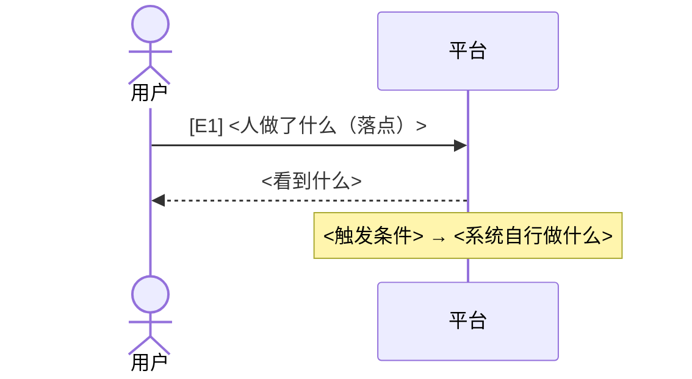

# Sequence

## 目标

接收一个**已经落地**的功能点，产出一份短文件。按 **出图门槛** 分两种形态：要画图时四段；不画图时是入口表、需要时加前提表，再加一行结果——入口有几个都按这一条，不看个数。

- **入口表**：从哪进、什么触发条件、落点在哪、核对过没有。这是 AI 定位代码的唯一入口。
- **时序图**：按什么顺序走、每步看到什么结果。
- 前提与拒绝（可选）：什么身份、什么初始状态、什么必须被拒。
- 状态副作用（可选）：每步之后该出现或变化什么。

产物有三个用途：人一眼扫过看清流程；AI 顺着入口表找到代码，按图理解顺序；测试照图跑一遍，用来证明「图与代码在这个 commit 上对得上」。

只给入口、顺序与结果。参数、鉴权、错误码、字段、实现路径都不在里面，以代码为准。

**图不自我证明。** 它只能说明「在某个 commit 上照它跑通过」，不能说明现在的代码还对得上；业务流程正不正常，由人判断。

## 前置条件

### 必要输入

- 一个已落地的功能点：编号与名称，一句话也行。底本里没有名称时问一句，不自己编一个。
- 可选：一份范围文档（例如 `docs/<需求名>/<编号>.md` 的做与不做表），用来定哪些该进图、哪些说了不做。
- 合成的功能点：额外给出它由哪几块组成，按编号与名称列出。

### 什么时候画

- **只画现状**：代码已经落地，落点读得到、验得了。
- 还没落地的功能点不画。设计阶段要对齐流程，就在对话里画草图：不落盘、不套本文件的格式与验收。真要留在仓库里，等实现后画这张现状图。
- 同一段流程只有一张图，就是当前实际怎么走；不保留「上一版打算怎么走」。

### 输出位置

- 默认与底本同目录；没有底本时写当前目录。名字 `<编号>-<功能点名>-时序.md`；编号未给时用 `01`。
- 开发人员指定位置时按指定的写。

### 参考文件

- 示例：`assets/sequence-example.md`，落盘前对照一次。

### 缺失处理

- 功能点还没落地：说明本技能只画现状、不画计划，等落地后再画；不硬画一张计划图凑数。
- 落点读不到：先问；确认确实没有入口的，不进入口表，按被动结果写成带触发条件的 Note。
- 功能点名取不到：问一句，不自己编。
- 改换另一个功能点时，从步骤 1 重新开始。

## 执行步骤

### 步骤 1：自己先把入口、参与方与步骤定下来

- 读代码，够判断入口、参与方、顺序与结果即可；上下游没写明的不自行补。
- 定入口：谁启动、启动几次，逐个写成类型 + 触发条件 + 唯一落点 + 是否要人工或外部输入。
- 合成功能点：把各块的入口合到同一张表，E 编号从 E1 起重排。去重只在**类型、触发条件、落点三者都相同**时合并；落点相同但职责不同的不合并，用两个编号，在触发条件里写清区别。
- 按 **出图门槛** 判断要不要画图；不画时，准备一行「结果」。
- 定参与方：按 **参与方** 的判据取，一般只有用户与本系统。
- 定步骤：入口、跨边界的调用、有先后依赖的大逻辑、人能看到的结果；每个入口进图后紧接着要有它的结果。
- 定两张可选表：有身份或初始状态前提、或有必须被拒的动作时写前提表；有副作用的步写状态副作用表。
- 拿不准的按推荐填，别留着不填；不拆成多轮提问。
- 完成标志：入口、参与方、步骤、每步结果都有了，画不画图已定，两张可选表要不要写也定了。

### 步骤 2：一次成稿，整份给开发人员改

- 一次把内容一起给全，整份贴出来，不分开报、不报进度、不写文件。
- 表外最多一句，点出哪几处是推断的；行数明显偏多时（例如超过 20 行），再点出哪几行请重点看。
- 请开发人员补漏、改顺序、删掉不做的步骤、指出要拆的地方；只改几处时其余按草稿保留。
- 说不行但没说怎么改时问方向，不自行推演。
- 代码与开发人员说的不一致，或代码本身绕了路、有跳过、有重试时，按实际画，同时标出来问一句，不自判哪种算对。
- 完成标志：内容已整份展示，开发人员已提过修改。

### 步骤 3：确认、验落点、落盘

- 按回答改，改完整份再贴一次；确认后逐个验入口表的「唯一落点」是否还在（读代码或 `grep`）。
- 验到的在「核对」列写 `已验`；验不了的写 `未核对`，在核对基线里写明原因。
- 记下验落点时读的那一版 commit（`git rev-parse --short HEAD`）和日期，写进核对基线；不在 git 仓库里就写「不入版本库」。
- 图能渲染就渲染确认；环境里没有渲染器时按 **Mermaid** 一节人工检查，并在交付里写「未渲染校验」。
- 写入文件，报告路径与编号，然后停。
- 完成标志：文件已写、核对列与核对基线已记、路径与编号已报。
- 没拿到确认就不写文件：拿不到开发人员回答时停在草稿，不落盘，也不假装确认过。

## 约束

### 入口

- 类型只有五类：页面动作、API、定时任务、消息订阅或事件、回调（含 webhook）。
- **API** 指一次会打到后端的请求：用户点按钮触发的、页面打开后自动触发的，都单独占一行，触发条件里写清是哪种；落点写 method + path。**页面动作**只在「打开这个页面本身就是一步、且这一下不打后端请求」时使用，落点写路由。凡是打到后端的请求都要有自己的一行，否则入口表就不完整，AI 会找不到那个接口。
- 每个入口一行：编号（E1 起）、类型、触发条件、唯一落点、是否需人工或外部输入、核对过没有。
- 唯一落点写到能直接检索：HTTP 写 method + path；页面写路由；定时任务写 cron 或调度点；消息订阅写 topic；回调写回调路径。
- 只有定时任务、消息订阅这两种没有 HTTP 地址的入口，在落点不唯一时，才在落点格内补 `（<类名>#<方法名>）`，例如 `cron 0 */5 * * * *（OrderTimeoutCancelJob#scanAndCancel）`。这是全文唯一允许出现类名与方法名的地方；HTTP 入口、页面动作与回调都不写。
- 文件路径、行号、表名、字段一律不写。
- 图上每条入口箭头以 `[E1]`、`[E2]`… 开头；每张图上出现的编号都能在入口表里找到，入口表里的每个编号合计在各图中有起点。拆过图的按这条合计口径核，不按单图核。
- 外部发起的入站调用（支付回调、webhook、外部投递的消息）不从第三方起箭头，画成本系统自环，标签以 `[E1]`… 开头并写 `外部发起：<谁> → <事件>`；这类自环属入口，不算自主行为。
- 定时任务、消息订阅这类自己发起的入口，也用系统自环，标签写 `<触发条件> → <动作>`，与外部发起那类靠标签前缀区分。
- 写不出落点的不算入口。被动结果（例如验证码到点自己失效）不进入口表，写成带触发条件的 Note。

### 出图门槛

按这一条判：**本图某一步写入的业务对象或状态，被本图的后续步骤读取或依赖**（跨步状态传递）；或者**图上要画 alt**；或者**多个入口作用于同一业务对象、结果互斥，得分段说清竞态**。任一条成立就画图。

都不成立就不出图，只留入口表与结果行。入口个数不作判据：多入口之间没有先后因果的，也不画——把并列的请求连成顺序会伪造先后，并列列在入口表里就够。

跨步状态传递要限在本图内：后一步依赖的必须是本图前面某一步写下的东西，不是功能点外面早就存在的状态（登录会话这类），否则等于人人达标。

分段画竞态时，分支上限按每段各两条计，不按整图合计；某一段自己超过两条，再按原规则拆图。

### 参与方

- 只有能被调用、且调用结果能被核对的对象才占一条生命线。
- 常态两个：用户（或操作者）与本系统。
- 没有用户端的功能点只有本系统一条，从第一个入口起画。
- 第三方服务（短信、邮件、支付、模型）折进本系统写进箭头标签，不单开生命线；确实跨了另一个能独立调用、也能被 AI 测的系统时，才加第三条，并先在对话里确认。
- 数据库不占生命线。系统内部的层（Service、Handler、Repository）不占线。

### 粒度

- 只记入口、跨边界的调用、有先后依赖的大逻辑。
- 每步至少一个可核对结果：用户看得到的结果，或库端业务对象该出现的变化（写业务对象，不写表名与字段）。结果是「没有变化」时写成「不处理，<对象>仍为<状态>」，不写成空话。
- 箭头标签用业务动作写，能读给不懂代码的人听；写不出业务动作的说明这步太细，往上收或折进标签。
- 一条箭头只写一件事；挤了两件事就拆开。
- 用户侧写清点了什么、看到什么；纯界面交互（滚动、清空、焦点）不画。
- 不写字段、参数、状态码、表结构、SQL、接口签名、测试用例。
- 「中间步」指非入口的箭头，它们没有代码锚点。

### 分支与自主行为

- 同一入口下实际会分成两条走法的，用 alt：人会走到的另一条路，或系统按状态走的两条路都算。
- 多个入口作用于同一业务对象、结果还互斥的（同一订单的取消、超时取消、支付到达，谁先到谁生效），各画一段、段间不加箭头，用 Note 写明是竞态；不把它们排成一条时间线，那是在编顺序。
- 整张图最多两条分支，一条 alt 里可以用 else 再分一条；超过说明这功能点该拆。分段画的竞态图按每段各两条计，不按整图合计。
- 调用顺序本身不同、且两条路都常走时，才另开一张图；其余一律 alt。
- 空数据、满量、重名这类边界不在图上穷举。
- 开发人员说了不做的行为图上不得出现；发现出现在图上，当场删掉并告诉开发人员。
- 过期、超时、重试、补偿这类不靠用户触发的步骤：有落点的进入口表，从系统生命线起画；没有落点的写成带触发条件的 Note。
- 写不出触发条件的自主行为不画。

### 前提与拒绝（可选）

- 只在有前提时写：身份一行、初始状态一行、必须被拒的动作若干行，合计最多五行。
- 「必须被拒」是测试用的负例，不进图。判断一个动作该进图还是进这里，看代码或页面上是否真的暴露了它：暴露了、用户能主动触发，就是一条路，画 alt；没暴露、只能靠构造请求触发，才写进这里。读不到页面时按代码里的校验判断，并在交付里说明依据。
- 已经画成 alt 的行为不要再写进这里。
- 没有前提就整节省略。

### 状态副作用（可选）

- 只列有副作用的步骤，一行一条；同一入口有多条副作用就分行写。
- 一行三列：入口编号、业务对象（会话、订单、库存、验证码记录这类）、该步之后应出现或变化什么。
- 效果不由任何入口触发的（纯系统自主完成的），入口列写「自主」。
- 不写表名、字段、SQL、状态码；它是给人核对与测试用的输入，不是实现断言。
- 没有副作用就整节省略。

### 核对基线与过期

- 头部必须有 `核对基线：<commit> <日期>（落点已验 N/M）`。commit 是验落点时读的那一版，写短哈希；工作区当时有未提交改动就在后面加 `+dirty`。
- 取不到 commit 时（不在 git 仓库、只读快照、导出的压缩包），写 `核对基线：不入版本库 <日期>（落点已验 N/M）`，并在交付里说明为什么取不到。
- 基线 commit 已经不在历史里时（浅克隆、rebase、强推），按「基线不可达」处理：重新验落点、改写基线与日期，并在交付里说明旧的已不可追溯。
- 落点一个都没验（N=0）的，一律按可疑处理：先验入口再用。有一条以上未核对的，就在交付里列出未核对项，并说明这张图能不能直接用。
- **图不自我证明。** 它只证明「在这个 commit 上照它跑通过」，不证明现在的代码还对得上。
- 本技能不执行验证。跑由使用它的人、或测试与 CI 做；技能只负责把图画成跑得动的样子。
- 基线带 `+dirty` 时，这张图对应的代码已不可复现：使用前必须重验，不能拿它当某个 commit 的事实。
- 怀疑过期时，先做一次廉价预警：拿基线 commit 和当前 HEAD 对入口落点做 diff。落点字符串被改过，基本就是图该更新；落点没被改过**不能**据此认为图没问题——顺序、步骤数、分支的变化 diff 不出来。基线是 `不入版本库` 的跳过这一步，直接照跑或标未跑。
- 真正的判定是照图跑一遍：跑得通，说明图与代码在这一版上对得上；跑不通，再按预警结果分是图旧了、图画错了，还是环境问题，交开发人员判断。业务流程本身对不对，人负责。
- 交付里要说明这批落点有没有照图跑过；没跑过就只算「落点存在」，不算「图与代码对得上」。
- 使用方发现图与代码不符时，不改图、不重画，在文件里回写一行 `stale@<日期> <原因>`，并把差异记成「图过期」，不得据此判实现失败。
- 重画只在本技能再次被调用时做，按当前代码整份重画。

### Mermaid

- 标签里不写 `;` 与 `#`；URL 只留路径，不带域名。
- 单张图消息不超过 15 条，超了拆图；消息条数按除 Note 以外的箭头计。拆图时按图 1、图 2 排在同一份文件里，入口编号沿用入口表、不重编。
- 能渲染就渲染确认（PR 预览或本地渲染）；环境里没有渲染器时，人工核对「消息条数、标签禁用字符、alt/end 配对」，并在交付里注明未渲染校验。渲染不通过的图不得落盘。

### 边界

- 不写实现步骤、接口签名、技术选型与测试代码。
- 不写文件路径、行号、类名、方法名；「入口」一节允许的落点括注除外。
- 不画未落地的功能点，不产出计划图。
- 范围由开发人员定；图上多出的步骤先问，不自行加也不自行删。
- 不开始写代码，结束后不接着画下一个功能点的图。
- 中途叫停时，已落盘的文件留在原处，下次从步骤 1 重新核对。

## 输出与验收

### 文件结构

按 **出图门槛** 判定要画图的：

````markdown
# <编号> <功能点名>

核对基线：<commit> <日期>（落点已验 N/M）

<!-- 取不到 commit 时写「不入版本库 <日期>」；工作区有未提交改动时写成 <commit>+dirty 并标不可复现 -->

入口类型：<五类中的一个或多个，用「、」分隔>
人工或外部输入：<没有就写「无」>

## 入口

| #   | 类型 | 触发条件   | 唯一落点        | 人工或外部输入 | 核对 |
| --- | ---- | ---------- | --------------- | -------------- | ---- |
| E1  | API  | <怎么触发> | <method + path> | 否             | 已验 |

## 前提与拒绝（可选，≤5 行）

| 类型 | 内容         |
| ---- | ------------ |
| 身份 | <谁可以触发> |

## 时序



## 状态副作用（可选，只列有副作用的步）

| 入口 | 业务对象 | 该步之后应出现或变化什么 |
| ---- | -------- | ------------------------ |
| E1   | <对象>   | <变化>                   |
````

按门槛判定不画图的：头部与入口表同上；有前提就照常写前提表；最后写结果，一个入口一行 `结果：<用户看到什么，或留下哪个业务对象及其状态>`，不写「时序」与「状态副作用」两节。结果要能被核对，写成「成功返回」不算。多入口但互不成因的也走这个形态，入口表并列列出，结果按入口逐行写。

### 交付内容

- 文件路径与编号。
- 落点核对结果：验了几个、几个未核对、为什么；有没有做渲染校验；这批落点有没有照图跑过。
- 有一条以上未核对时，单独列出未核对的落点，并说明这张图能不能直接用。
- 合成的功能点：去重合并掉了哪些入口（哪个块的哪条并进了哪个 E）。
- 「必须被拒」那条判断的依据：按页面暴露还是按代码里的校验判的。
- 范围文档里有「不做」项时，说明都核过、均未上图。
- 核对中删掉的越界步骤，有就说，没有不提。

### 验收标准

- 文件在预定位置，名字是 `<编号>-<功能点名>-时序.md`。
- 头部齐：编号与名称、核对基线（含 commit 或 `不入版本库` 的说明、日期、验了几个；带 `+dirty` 的按其形态核）、入口类型、人工或外部输入。
- 入口表每行都有编号、类型、触发条件、唯一落点、人工或外部输入、核对结论；核对列只有 `已验` 与 `未核对` 两个值。
- 落点可直接检索命中；取不到 commit 或取不到代码的地方，已写 `不入版本库` 或「未核对」并说明原因。
- 按 **出图门槛** 判断出的确有图：跨步状态传递或 alt 至少占一条；不满足的只有入口表（需要时加前提表）与一行结果，没有为它硬凑图。
- 不画图的形态里，结果行写的是可核对的东西（看到什么、留下什么对象与状态），不是「成功返回」这类空话。
- 有图时：每条入口箭头以 `[E1]`、`[E2]`… 开头；每张图上的编号都在入口表里，入口表的每个编号合计在各图中有起点；拆过图也按这条合计口径核。
- 互不成因、结果互斥的多个入口，是分段画的、段间没有箭头，并用 Note 写明了竞态；没有把它们排成一条时间线。
- 外部发起的入站调用画成系统自环，标签写明 `外部发起：<谁>`；自主发起的入口自环写 `<触发条件> → <动作>`；两者都没有被画成普通自主行为。
- 每个入口进图后紧接着有它的结果；每步至少一个可核对结果；「不处理，<对象>仍为<状态>」也算；没有只写「调用某方法」的箭头。
- 中间步没有任何代码锚点；全文没有文件路径、行号、表名、字段；类名与方法名只出现在入口落点格的括注里，且只在定时任务、消息订阅两种入口上。
- 参与方只有用户与能调用、能核对的对象；数据库不占线；第三方折进标签。
- 分支不超过两条；说了不做的不在图上；系统自主行为带触发条件，没有落点的写成 Note。
- 有前提表时不超过 5 行，「必须被拒」没有同时画进图里。
- 有状态副作用表时一行一条，只用业务对象；第一列是入口编号或「自主」，没有顺序号。
- Mermaid 渲染通过，或已按人工核对项检查并在交付里注明未渲染校验；标签无 `;` 与 `#`；消息不超过 15 条。
- 文件里没有「计划」「未落地」「部分已落地」这类状态；画的是当前代码实际怎么走。
- 交付里报全了这几项：文件路径与编号、落点核对结果与未核对项及影响、有没有照图跑过、有没有做渲染校验、合成去重留痕、「必须被拒」的判定依据、范围文档「不做」项的核对、核对中删掉的越界步骤。
- 文件内容原样贴出并确认；只处理了这一个功能点。

## 示例

功能点「01 短信验证码登录」，做完能看到「没登录的人用手机号与短信验证码换到登录态」。代码已落地，三个落点都验到了，核对基线指在当时的 commit 上。

三个入口都是 API：取图形验证码、请求下发短信、提交登录。参与方只报用户与平台；短信服务是「请求下发短信」的内部实现，折进箭头标签写成「平台内调短信服务下发」。

这张图有跨步状态传递（先下发验证码记录，后用它登录），所以出图。除了入口表和图，还写了两张可选表：前提与拒绝三行（仅未登录用户、手机号不在冷却中、未先取图形验证码的登录请求必须被拒）；状态副作用两行（下发后验证码记录新增一条待用验证码，登录后会话新增一条登录会话）。

确认草稿时说「重复请求不再下发也得画」，这是前面没对过的新步骤：它由用户请求触发、页面上也真实暴露，画成 alt，不写成 Note。成品见 `assets/sequence-example.md`。

合成的功能点按各块入口合并去重、E 编号重排；去重只在类型、触发条件、落点三者都相同时合并，落点相同但职责不同的用两个编号。

底本是范围文档时最易画成清单转移：做与不做表上写着十来条，不代表图上要十来条箭头。箭头按因果连，范围文档只用来定哪些该在、哪些不该在，以及哪些说了不做。

底本只有一段代码时，上下游往往不在手上。缺的按开发人员说的补，并在对话里逐条指出哪几步是补的；补不上的落点标未核对，不硬写一个凑数。

短图就是它该有的样子：整条流程只有一次调用时，按门槛根本不出图。

比如功能点「02 查询余额」，只有一个入口 `GET /api/account/balance`，打开余额页就自动拉一次，没有跨步状态传递、也没有分支。这份文件是头部、前提表、一行入口表，加一行结果：

```markdown
# 02 查询余额

核对基线：4a7c1e9 2026-11-18（落点已验 1/1）
入口类型：API
人工或外部输入：无

## 入口

| #   | 类型 | 触发条件                 | 唯一落点                 | 人工或外部输入 | 核对 |
| --- | ---- | ------------------------ | ------------------------ | -------------- | ---- |
| E1  | API  | 打开余额页后自动请求一次 | GET /api/account/balance | 否             | 已验 |

## 前提与拒绝

| 类型 | 内容           |
| ---- | -------------- |
| 身份 | 仅登录用户可查 |

结果：用户看到最新的账户余额数字。
```

为它画一张两条箭头的图，只是把入口表和结果再说一遍，还多一个要维护的东西。
