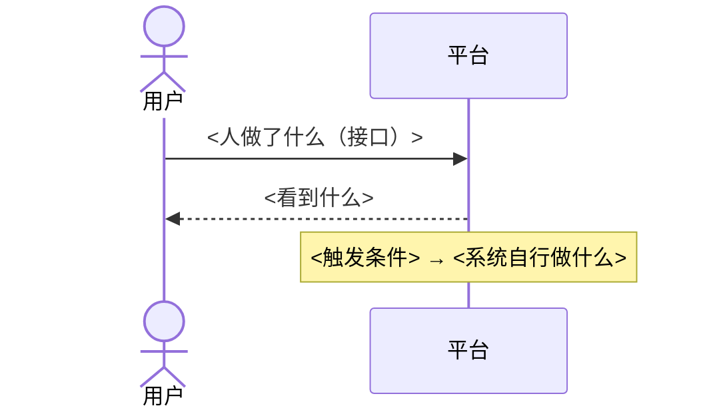

# Sequence

## 目标

接收一个功能点，画一张业务级时序图：谁触发、按什么顺序调谁、大逻辑的先后，以及不靠用户触发的那几步。

功能点可大可小：可以是一个还没动手的小功能点，也可以是几块已经分步做完、要合成一个整体的功能点；后者按合并后的完整流程画一张。

图有两个用处：人照着核对调用顺序与先后，AI 照着写接口测试与页面测试。因此只画人一眼看得到、AI 调得到也查得到的东西：每一步要么是人能做的一步，要么是 AI 能直接发出的请求，要么是系统按触发条件自己做的一步。

不写字段、参数、SQL、接口签名与测试用例。

## 前置条件

### 必要输入

- 一个功能点：编号与名称，一句话也行。
- 合成的功能点：额外给出它由哪几块组成，按编号与名称列出，并确认几块都已完成。

### 可读

- 触发点相关的页面与接口代码，读够判断「从哪进、经过谁」即可。

### 图的来源

两栏都定，缺一不可，在文件开头一行写明。

性质，决定这张图能不能当事实看：

- 计划：功能点还没落地，图上是打算怎么走。
- 现状：代码已经在跑，图上是实际怎么走。

底本，决定从哪里读：

- 一句话：最粗，没有可读的东西。
- 设计方案：流向已定，但常写到类与方法一级。
- 边界清单：只有范围，没有流向。
- 一段代码：上下游可能不在手上。
- 几块已完成：每块各自完整，合起来才是整条流程。

性质与底本不相干：底本是已有代码，也可以画下一版打算怎么走，那就是计划。

### 输出位置

- 默认写在当前目录，名字 `<编号>-<功能点名>-时序.md`；编号未给时用 `01`。
- 开发人员指定位置时按指定的写。

### 缺失处理

- 只有一句话、看不出要碰什么时，先问一句范围，不自行补全。
- 性质或底本判断不了时问一句，不自行归一栏。
- 推断出来的流向与开发人员说的不一致时，问一句按哪个画，不自行选一个。
- 触发点写不出落点时先问；确认确实没有入口的，不进清单，按被动结果挂 Note。
- 改换另一个功能点时，从步骤 1 重新开始。

## 执行步骤

### 步骤 1：定来源、触发点与参与方

- 操作：
  - 先定性质与底本，再按底本读：一段代码只读这段，不自行补上下游；设计方案只取流向，不取类名；几块已完成分别读一遍，按调用顺序接起来；一句话跳过读码，直接列。
  - 列触发点：这条流程由谁启动、启动几次，逐个写成代码里的哪一处落点。
  - 定参与方：按 **参与方** 的判据取，一般只有用户与本系统两个。
  - 列出认为该进图的步骤，与开发人员对一遍，多出的删掉、缺的补上。
  - 把触发点清单、参与方清单与步骤清单报给开发人员，确认后再画；确认前不往下走。
- 完成标志：性质与底本已定；三份清单已由开发人员确认；首尾两步已写进步骤清单。

### 步骤 2：画主路径

- 操作：
  - 按 **图格式** 先画出完整初稿，只写大调用与大逻辑，写完即落盘。
  - 一条箭头只写一件事：一次页面动作、一次接口调用、一次看得到的结果或一次带触发条件的系统自主行为，挤了两件事就拆开。
  - 有分支或系统自主行为时，按 **分支与自主行为** 的规则画。
  - 需要查库佐证时，在文末写「这一步之后能查到什么」。
  - 一段代码作底本、上下游有缺时，补的步骤在文末列一行。
- 完成标志：没有内部方法调用的箭头；每一步都能在步骤清单里对上；文件已写出。

### 步骤 3：逐轮核对并就地落盘

- 操作：
  - 每轮把整份文件内容贴出来，从这几类里取 2 到 3 个问：哪一步顺序不对、还缺哪一步、哪一步其实不做、哪一步能拆成两步、超时与失败要不要进图。
  - 回答照办，改完再贴。
  - 参与方或触发点被改动时，连图一起重画，并重新确认一遍清单。
  - 回答里出现没对过的步骤时，先停下来问人，不自行扩大范围。
  - 每轮结束就更新文件，不攒到最后。
- 完成标志：图上每一步与顺序已由开发人员确认，没有未处理的争议点。

### 步骤 4：验收并结束

- 操作：对照 **验收标准** 逐条核对，修正后重查；报告文件路径与编号，然后停。
- 完成标志：验收全过，输出停在报告处。

## 约束

### 参与方

- 只有能被调用、且调用结果能被核对的对象才占一条生命线。判据：AI 能不能对它发出一次调用，能不能核对返回；两条都不成立就不进图。
- 常态只有两个：用户（或操作者）与本系统。
- 没有用户端的功能点，例如定时任务、回调、清理任务，参与方只有本系统一个，图从第一个触发点起画。
- 短信服务、邮件、支付网关、模型这类第三方，是被调用行为的内部实现，AI 既调不到也核不了，折进本系统那一端写进箭头标签，例如「平台内调短信服务下发」。
- 数据库不占生命线：它只被查、不被调，写在文末「可查」里。
- 确实跨了另一个能独立调用、也能被 AI 测的系统时，才加第三个，并先在对话里确认。
- 不写类、Service、Handler、Repository、表名与文件名；系统内部的层不占生命线，它们的顺序归单元测试。

### 触发点

- 每个触发点一行：谁启动 → 代码里的落点。落点是能指出来的一处：接口路径或方法名、定时任务的调度点、消息订阅或事件监听的方法。
- 触发点可以是页面动作、接口调用、定时任务或回调；后两种写成「条件 → 落点」。
- 落点取代码里的真实名字；还没落地的功能点写计划采用的接口路径或方法名，并标一句待落地，不编一个占位置的路径凑上。
- 写不出落点的不算触发点。被动结果不算，例如验证码存在 Redis 里到点自己失效，它没有入口。
- 触发点要能在图上认出来，它就是某条箭头的起点。
- 一个功能点有几个触发点就写几行，不合并成一个「入口」。

### 粒度

- 只记触发点、跨边界的调用与有先后依赖的大逻辑。
- 不写字段名、参数、状态码、表结构、SQL；返回只写人能看到的结果。
- 箭头标签用业务动作写，能读给不懂代码的人听；写不出业务动作的，说明这步太细，往上收或折进标签。
- 用户那一侧要写清点了什么、看到什么。
- 业务上一步做完的事不拆，只在「人能感知到分两次」时才拆。

### 分支与自主行为

- 人会真实走到的另一条路用 alt 包起来；整张图最多两条分支，一条 alt 里可以用 else 再分一条，超过说明这功能点该拆。
- 调用顺序本身不同、且两条路都常走时，才另开一张图；其余情况一律 alt，不按分支拆图。
- 空数据、满量、重名这类边界不在图上穷举。
- 开发人员说了不做的行为图上不得出现；发现出现在图上，当场删掉并告诉开发人员。
- 过期、超时、重试、补偿这类不靠用户触发的步骤：有落点的按触发点写进清单，从系统生命线起画；没有落点的才写成 Note，挂在系统生命线上，并带触发条件。
- 写不出触发条件的自主行为不画。

### 数据库佐证

- 只写「这一步之后能查到什么」，一类记录一句，不写字段与 SQL。
- 不靠查库就能判断的步骤不写。
- 查库只用于佐证流程走通，不替代图上的顺序。

### 来源

- 性质与底本都要写，不省成一句「来源：代码」。
- 计划不冒充现状：性质是计划时，开头那句尚未落地不能省，就算底本是真代码也一样。
- 设计方案的类名与方法名不进图，只取它的流向；抬不到角色级的步骤，宁可折进箭头标签。
- 边界清单不当箭头清单用：每一步要有因果，不是因为清单里有这一行才画。
- 一段代码推断时，缺的上下游按开发人员说的补，图上注明哪几步是补的，并在对话里逐条指出。
- 推断只记代码实际怎么做，不顺手把你想让它怎么做写进去。
- 代码与开发人员说的不一样，或代码本身绕了路、有跳过、有重试时，照实画，同时在对话里标出来问一句，不自行判断哪种算对。
- 一个功能点从计划变成现状时，按当前真实情况重画，不把两种来源混在一张图上。

### 边界

- 不写实现步骤、接口签名、技术选型与测试代码。
- 范围由开发人员定；图上多出的步骤先问，不自行加也不自行删。
- 不开始写代码，结束后不接着画下一个功能点的图。
- 中途叫停时，已落盘的图留在文件里，下次从步骤 1 重新核对。

## 输出与验收

### 图格式

````markdown
# <编号> <功能点名>

来源：<计划或现状，计划的标尚未落地>，底本为<一句话、设计方案、边界清单、一段代码或几块已完成>

触发点：

- <谁触发> → <代码里的落点：接口路径、方法名或调度点>
- <触发条件> → <代码里的落点>

<一句话：这张图说明什么>



可查：

- <哪一步之后>：<能查到哪类记录>

补的步骤：<哪几步是补的；没有就不写这行>
````

箭头标签里带接口路径或动作名。第三方服务写进箭头标签，不单开生命线；按 **参与方** 确认要单开的除外。没有用户端的功能点，第一条箭头从触发点指向本系统自己，例如 `P->>P: 每分钟扫描超时订单`。完整示例见 `assets/sequence-example.md`，落盘前对照一次。

### 交付内容

- 文件路径与编号。
- 核对中删掉的越界步骤，有就说，没有不提。

### 验收标准

- 文件写在预定位置（默认当前目录），名字是 `<编号>-<功能点名>-时序.md`。
- 开头一行写明性质与底本；性质是计划的已标尚未落地；底本是一段代码时，文末已列补的步骤。
- 参与方、触发点与步骤三份清单都经开发人员确认。
- 参与方只有能被调用、结果能核对的对象；数据库写在「可查」里，不占生命线；没有确认过的第三方服务、类名、表名与文件名。
- 每个触发点都指得出代码里的落点，并在图上有起点；计划的触发点已标待落地。
- 每条箭头都是人能感知的一步，标签用业务动作写。
- 分支不超过两条；顺序不同的路已另开一张图；说了不做的行为图上没有。
- 系统自主行为带触发条件；写了可查的，一类记录一句。
- 人照着图能走完整条流程，没参与讨论的人读完能说出这个功能做什么。
- 没有字段、参数、SQL、接口签名、测试代码与测试用例。
- 文件内容原样贴出并确认；只处理了这一个功能点。

## 示例

功能点「01 短信验证码登录」，做完能看到「没登录的人用手机号和短信验证码换到登录态」。来源写现状，底本为一段代码。触发点三个：取图形验证码、请求下发短信、提交登录，各对应登录页一个动作与一个接口。参与方只报用户与平台；短信服务是「请求下发短信」的内部实现，折进箭头标签写成「平台内调短信服务下发」。三份清单先报给开发人员确认，再动笔画。

主路径三步：取验证码、请求下发短信、提交登录。验证码 60 秒未使用自行作废，不靠用户触发，也没有代码落点（靠 Redis 到点失效），所以不进触发点清单，只在图上挂一条 Note。核对时开发人员说「重复请求不再下发也得画」，这是前面没对过的新步骤，先问清再进图；它由用户请求触发，画成 alt，不写成 Note。贴出来确认后报路径与编号，然后停。成品见 `assets/sequence-example.md`。

另一个例子是合成：「发送与接收」三步已经分别做完，分别是发消息、存消息、取消息。性质写现状，底本写几块已完成，按合并后的完整流程画一张；触发点仍只有发消息那一个接口。

底本是设计方案时最易画成类级图：只取流向，抬到角色级，类名与方法名不进图；性质写计划，开头那句尚未落地不能省，验收前再对一遍。

底本是边界清单时最易走偏：清单上写着八条，不代表图上要八条箭头。箭头按因果连，清单只用来定哪些该在、哪些不该在。

底本只有一段代码时，上下游往往不在手上。缺的按开发人员说的补，落盘后在文末写一行「补的步骤」，指出哪几步是补的，免得分不清哪些是读出来的。

边界案例：整条流程只有一次页面动作加一次接口，只有一个触发点、两个参与方、两条箭头。照样出图，短图就是它该有的样子，不为好看添步骤。
