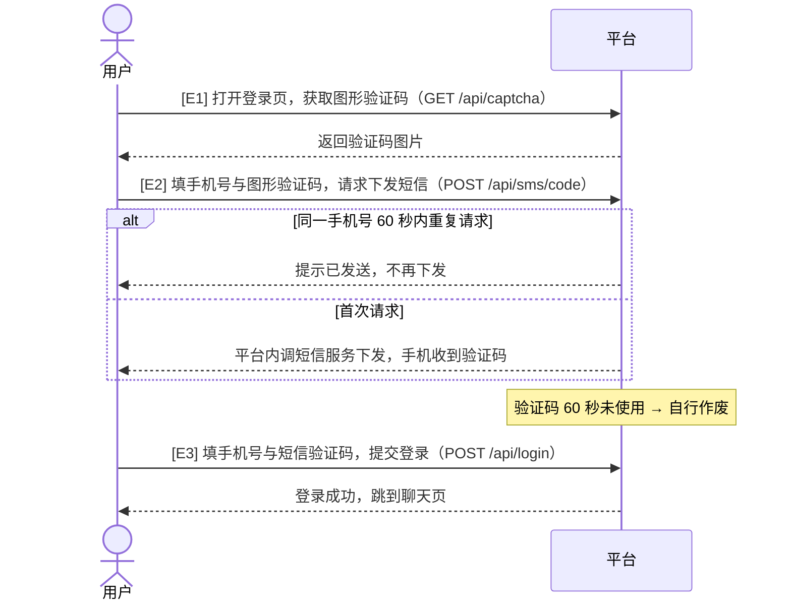

# 01 短信验证码登录

核对基线：4a7c1e9 2026-11-18（落点已验 3/3）
入口类型：API
人工或外部输入：短信验证码（要开发人员提供）

## 入口

| #   | 类型 | 触发条件                             | 唯一落点           | 人工或外部输入 | 核对 |
| --- | ---- | ------------------------------------ | ------------------ | -------------- | ---- |
| E1  | API  | 登录页点「获取图形验证码」           | GET /api/captcha   | 否             | 已验 |
| E2  | API  | 填手机号与图形验证码后点「发送短信」 | POST /api/sms/code | 否             | 已验 |
| E3  | API  | 填手机号与短信验证码后点「登录」     | POST /api/login    | 是，短信验证码 | 已验 |

## 前提与拒绝

| 类型     | 内容                         |
| -------- | ---------------------------- |
| 身份     | 仅未登录用户可触发           |
| 初始状态 | 手机号不处于 60 秒发送冷却中 |
| 必须被拒 | 未先取图形验证码就提交登录   |

## 时序

## 状态副作用

| 入口 | 业务对象   | 该步之后应出现或变化什么         |
| ---- | ---------- | -------------------------------- |
| E2   | 验证码记录 | 新增一条待用验证码，60 秒后失效  |
| E3   | 会话       | 新增一条登录会话，用户进入登录态 |
